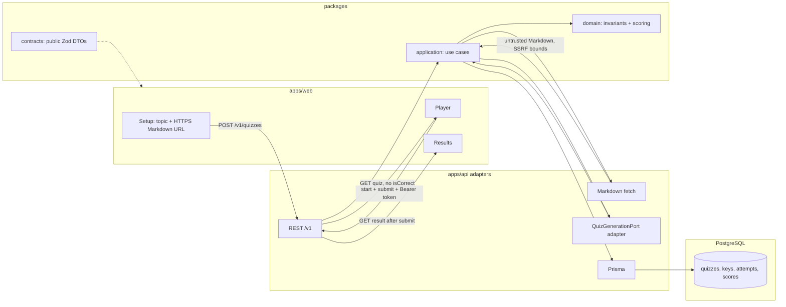

# Architecture and data flow

The web app talks only to the public REST API. Scoring, answer keys, and model calls stay on the server.

## Hexagonal boundaries

| Layer | Lives in | May import |
| --- | --- | --- |
| Domain | `packages/domain` | nothing from Nest, Prisma, Next, OpenAI, Langfuse |
| Application | `packages/application` | domain + ports |
| Public contracts | `packages/contracts` | Zod only; no answer keys |
| Inbound/outbound adapters | `apps/api` (`quiz/`, `attempt/`, `platform/`, `eval/`) | ports, Nest, Prisma, Vercel AI SDK, Langfuse |
| Browser | `apps/web` | contracts + UI primitives |

## Learner path (one sitting)

1. Topic and configurable HTTPS Markdown URL (GitHub `blob` URLs are normalized to raw when appropriate).
2. Server fetch: timeouts, size cap, public destinations only. Markdown is **task data**, not instructions.
3. Snapshot + SHA-256 checksum persisted on `SourceDocument`.
4. Generation through `QuizGenerationPort` (structured output, 5–8 questions, four options).
5. Validate and persist in one transaction, or fail without a playable quiz.
6. `GET /v1/quizzes/:id` returns prompts and labels only.
7. `POST .../attempts` issues a one-time bearer token; only the hash is stored.
8. Submit grades with Phase 1 policy (`4` or `0` single; one point per correct multi option, 0–4; weights `1.1 ** index`) inside a transaction. Repeat submit returns the same result.
9. Result includes the stored 0–4 weighted score and optional percentage for display.

Evaluation (`evals/`, `pnpm eval:golden`) is a reviewer path. It does not change learner scores.
