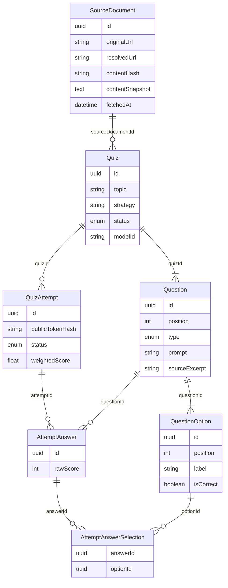

# Persistence model

PostgreSQL via Prisma. `QuestionOption.isCorrect` is **server-only** and must not appear on pre-submit API responses, page props, or HTML.

## Uniqueness and ownership

- `(quizId, position)` — question order
- `(questionId, position)` — four option slots
- `(questionId, label)` — unique labels per question
- `(attemptId, questionId)` — one answer row per question
- `publicTokenHash` unique; the raw token is shown once at start and never stored
- Selections must belong to that question

Quiz `status`: `generating` | `ready` | `failed`. Attempt `status`: `open` | `scored`. Playable answer keys are immutable. Scoring and finalization run in one transaction.

Weighted score is stored on the **0–4** scale. `weightedScoreDisplay` and `percentageDisplay` are rounded for display only.
